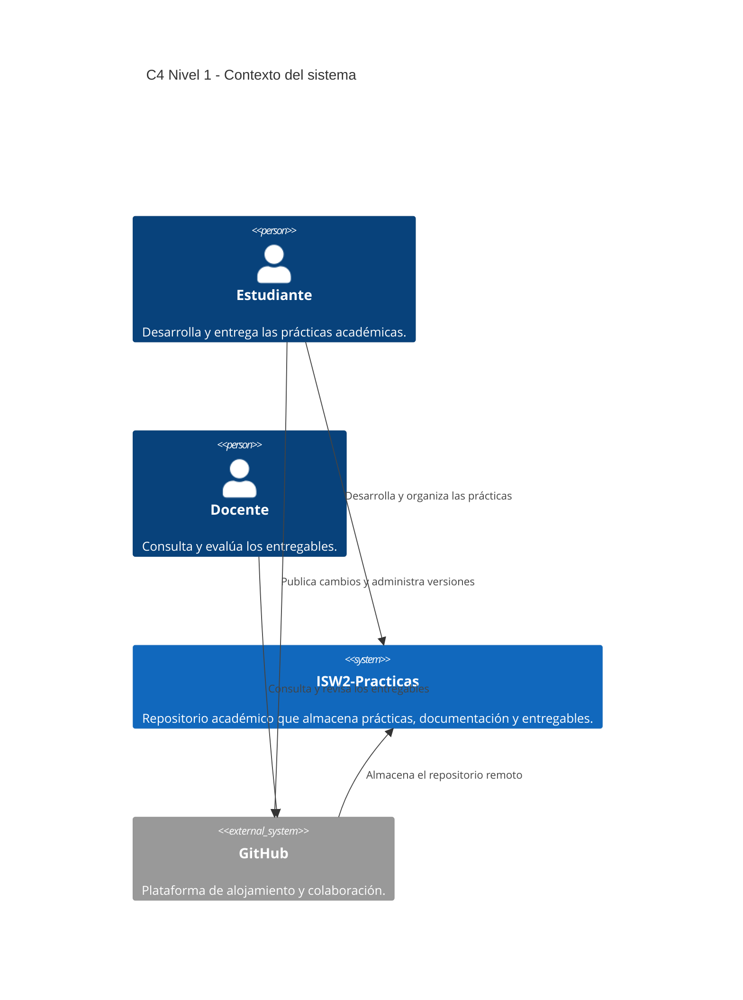
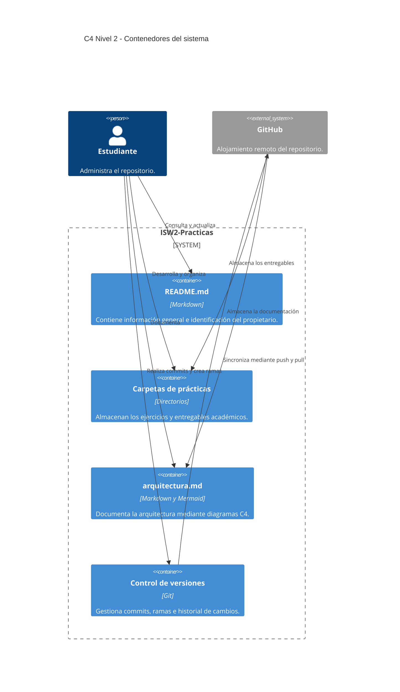

# Arquitectura del repositorio ISW2-Practicas

## 1. Descripción general

El repositorio ISW2-Practicas tiene como objetivo organizar y almacenar las actividades académicas desarrolladas durante la asignatura de Ingeniería de Software II.

Su estructura permite mantener las prácticas separadas, documentar los trabajos realizados y utilizar Git y GitHub para administrar los cambios y el historial del proyecto.

## 2. C4 Nivel 1: Diagrama de contexto

El diagrama de contexto representa la interacción entre los usuarios y el repositorio, identificando los actores principales y los sistemas externos.

### Justificación

El estudiante representa al usuario principal del sistema, encargado de desarrollar y organizar las prácticas. GitHub proporciona el entorno para almacenar el repositorio y gestionar los cambios mediante ramas y Pull Requests.

El docente interactúa con la plataforma para consultar los entregables y evaluar el trabajo realizado. Este nivel permite identificar el propósito del repositorio y sus principales relaciones externas.

## 3. C4 Nivel 2: Diagrama de contenedores

El diagrama de contenedores representa la organización interna del repositorio y los principales elementos que lo componen.

### Justificación

El repositorio está organizado en cuatro componentes principales:

- **README.md:** contiene información general e identificación del propietario.
- **Carpetas de prácticas:** permiten separar y organizar los ejercicios académicos.
- **arquitectura.md:** documenta la estructura y las relaciones del sistema mediante diagramas C4.
- **Git:** permite controlar las versiones, registrar modificaciones y trabajar mediante ramas independientes.

GitHub funciona como plataforma de almacenamiento remoto y permite integrar cambios mediante Pull Requests.

## 4. Conclusión

La arquitectura propuesta permite comprender la estructura y funcionamiento del repositorio ISW2-Practicas desde una perspectiva externa e interna. La separación de las prácticas y la utilización del control de versiones facilitan la organización, mantenimiento y evaluación de los entregables académicos.
